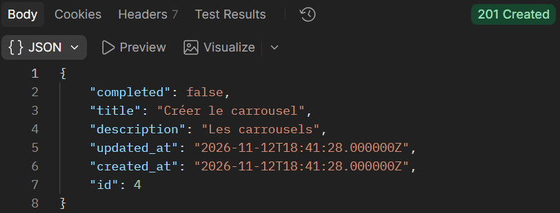
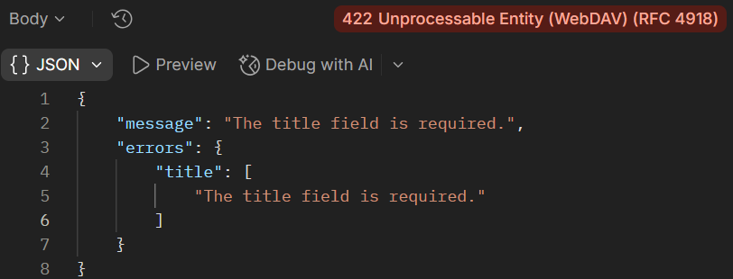

# Task Manager — API REST avec Laravel

[](https://github.com/Savifrancine/task-manager-laravel/actions/workflows/tests.yml)

> Série « De la théorie à la pratique » : construire pas à pas une API REST de gestion de tâches, avec un code commenté en français pour servir de support d'apprentissage.

| Démo | Sujet | Notions |
|---|---|---|
| **#01** | API CRUD | Migrations, Eloquent, contrôleur, routes, validation, codes HTTP, tests |
| **#02** | Authentification | Laravel Sanctum, jetons, relations, Policies, 401 vs 403 |
| **#03** | Docker | Image, conteneur, Dockerfile, docker-compose, volumes, ports |

## Démarrage rapide avec Docker (démo #03)

Seul prérequis : [Docker Desktop](https://www.docker.com/products/docker-desktop/). Pas besoin d'installer PHP, Composer ni MySQL.

```bash
git clone https://github.com/Savifrancine/task-manager-laravel.git task-manager
cd task-manager
docker compose up -d --build                     # construit et lance l'API + MySQL
docker compose exec app php artisan db:seed      # ajoute les comptes de démo (une seule fois)
```

L'API répond sur **http://127.0.0.1:8080/api**. Dans Postman, changer la variable `base_url` en `http://127.0.0.1:8080/api`.

| Commande | Effet |
|---|---|
| `docker compose ps` | Voir les conteneurs qui tournent |
| `docker compose logs app` | Lire le journal de l'API |
| `docker compose exec app php artisan test` | Lancer les tests **dans** le conteneur |
| `docker compose down` | Arrêter (les données sont conservées) |
| `docker compose down -v` | Arrêter **et effacer** la base |

**Comment c'est organisé :**

```
Windows                     Docker
───────                     ──────────────────────────────────────
localhost:8080  ──────────▶ conteneur "app"  (PHP 8.4 + Laravel, port 8000)
                                   │  DB_HOST=db
                                   ▼
localhost:3307  ──────────▶ conteneur "db"   (MySQL 8.4, port 3306)
                                   │
                                   ▼
                            volume "db-data" (les données survivent aux arrêts)
```

Les ports 8080 et 3307 sont choisis pour **ne pas entrer en conflit** avec `php artisan serve` (8000) et le MySQL de XAMPP (3306) : les deux installations peuvent tourner en même temps.

| Fichier | Rôle |
|---|---|
| [`Dockerfile`](Dockerfile) | La recette de l'image de l'API |
| [`docker-compose.yml`](docker-compose.yml) | Lance l'API et MySQL ensemble |
| [`docker/entrypoint.sh`](docker/entrypoint.sh) | Exécuté au démarrage : `.env`, clé, migrations, serveur |
| [`docker/.env.docker`](docker/.env.docker) | Configuration de l'API dans Docker |
| [`.dockerignore`](.dockerignore) | Ce qui n'entre pas dans l'image (`.env`, `vendor`…) |

## Le principe de l'authentification (démo #02)

```
1. POST /api/login  { email, mot de passe }   →  { "token": "1|aBcD…" }
2. GET  /api/tasks  Authorization: Bearer 1|aBcD…   →  uniquement MES tâches
3. POST /api/logout                                 →  le jeton est détruit
```

- **Authentification = « Qui es-tu ? »** : sans jeton valide → `401`.
- **Autorisation = « As-tu le droit ? »** : connecté, mais la tâche appartient à quelqu'un d'autre → `403`.
- Le mot de passe est **chiffré** en base et **jamais** renvoyé par l'API.
- Le propriétaire d'une tâche est toujours l'utilisateur connecté : `user_id` ne peut pas être envoyé par le client.

## Technologies

| Technologie | Utilité |
|---|---|
| PHP 8.4 / Laravel 13 | Backend |
| Laravel Sanctum | Authentification par jetons |
| MySQL (XAMPP ou Docker) | Base de données |
| Docker + Docker Compose | Lancer tout le projet en une commande |
| Eloquent ORM | Accès aux données et relations |
| PHPUnit + GitHub Actions | Tests automatisés à chaque push |
| Postman | Tests manuels de l'API |

## Endpoints

### Authentification

| Méthode | URL | Action | Succès | Jeton |
|---|---|---|---|---|
| `POST` | `/api/register` | Créer un compte | 201 | — |
| `POST` | `/api/login` | Se connecter, recevoir un jeton | 200 | — |
| `GET` | `/api/me` | Qui suis-je ? | 200 | ✅ |
| `POST` | `/api/logout` | Se déconnecter (détruit le jeton) | 200 | ✅ |

### Tâches (toutes protégées par jeton)

| Méthode | URL | Action | Succès |
|---|---|---|---|
| `GET` | `/api/tasks` | Lister **mes** tâches | 200 |
| `POST` | `/api/tasks` | Créer une tâche | 201 |
| `GET` | `/api/tasks/{id}` | Afficher une tâche | 200 |
| `PUT/PATCH` | `/api/tasks/{id}` | Modifier une tâche | 200 |
| `PATCH` | `/api/tasks/{id}/complete` | Marquer comme terminée | 200 |
| `DELETE` | `/api/tasks/{id}` | Supprimer une tâche | 200 |

### Erreurs gérées (toujours en JSON, en français)

| Code | Quand | Message |
|---|---|---|
| `401` | Pas de jeton, ou jeton invalide | `Non authentifié. Connectez-vous pour obtenir un jeton.` |
| `401` | Mauvais e-mail ou mot de passe | `Identifiants incorrects.` |
| `403` | La tâche appartient à un autre utilisateur | `Cette tâche ne vous appartient pas.` |
| `404` | La tâche n'existe pas | `Ressource introuvable.` |
| `422` | Données invalides | `Le champ titre est obligatoire.` |

## Installation sans Docker

Prérequis : PHP 8.3+, Composer, MySQL.

```bash
git clone https://github.com/Savifrancine/task-manager-laravel.git task-manager
cd task-manager
composer install
cp .env.example .env
php artisan key:generate
```

Créer une base MySQL `task_manager`, puis renseigner dans `.env` :

```env
DB_CONNECTION=mysql
DB_HOST=127.0.0.1
DB_PORT=3306
DB_DATABASE=task_manager
DB_USERNAME=root
DB_PASSWORD=
```

Créer les tables, les données de démo, puis lancer le serveur :

```bash
php artisan migrate --seed
php artisan serve
```

Comptes de démonstration (mot de passe `password123`) :

| E-mail | Tâches |
|---|---|
| `francine@example.com` | 3 tâches (id 1 à 3) |
| `alex@example.com` | 1 tâche privée (id 4), pour tester le `403` |

## Tester

**Tests automatisés** : 17 tests (base SQLite en mémoire, la base MySQL n'est pas touchée) :

```bash
php artisan test
```

**Intégration continue :** à chaque `push`, GitHub Actions relance automatiquement les tests ([`.github/workflows/tests.yml`](.github/workflows/tests.yml)). Le badge en haut de cette page indique le résultat.

**Postman :** importer [`postman/task-manager.postman_collection.json`](postman/task-manager.postman_collection.json). Lancer d'abord **« Se connecter »** : le jeton est enregistré automatiquement et envoyé par toutes les autres requêtes.

## Où regarder dans le code

| Fichier | Rôle |
|---|---|
| [`app/Http/Controllers/Api/AuthController.php`](app/Http/Controllers/Api/AuthController.php) | Inscription, connexion, déconnexion |
| [`app/Http/Controllers/Api/TaskController.php`](app/Http/Controllers/Api/TaskController.php) | La logique de chaque endpoint de tâches |
| [`app/Policies/TaskPolicy.php`](app/Policies/TaskPolicy.php) | La règle « seul le propriétaire peut agir » |
| [`app/Models/User.php`](app/Models/User.php) · [`Task.php`](app/Models/Task.php) | Les modèles et leur relation (un utilisateur → plusieurs tâches) |
| [`routes/api.php`](routes/api.php) | Routes publiques et routes protégées |
| [`bootstrap/app.php`](bootstrap/app.php) | Réponses d'erreur en JSON (401, 403, 404) |
| [`database/migrations/`](database/migrations) | Historique de la base, dont l'ajout de `user_id` |
| [`database/seeders/DatabaseSeeder.php`](database/seeders/DatabaseSeeder.php) | Données de démonstration |
| [`lang/fr/validation.php`](lang/fr/validation.php) | Messages de validation en français |
| [`tests/Feature/`](tests/Feature) | Tests de l'authentification et des tâches |

## Démo #01 — Aperçu

| Création réussie (201) | Données invalides (422) |
|---|---|
|  |  |

📄 Le carrousel explicatif de la démo #01 : [`carrousel-task-manager.pdf`](captures/carrousel/carrousel-task-manager.pdf)

## Pistes d'évolution

- Priorités et dates limites
- Pagination et filtres (`?completed=true`)
